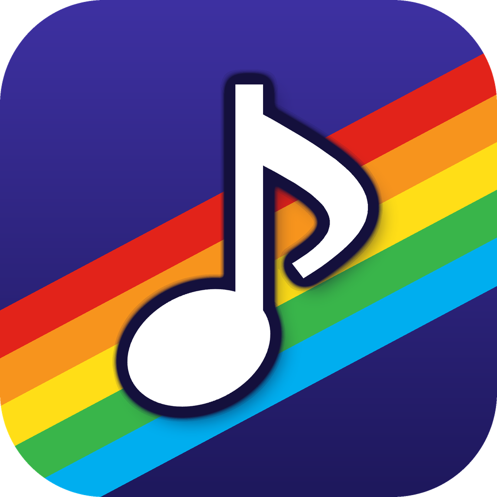
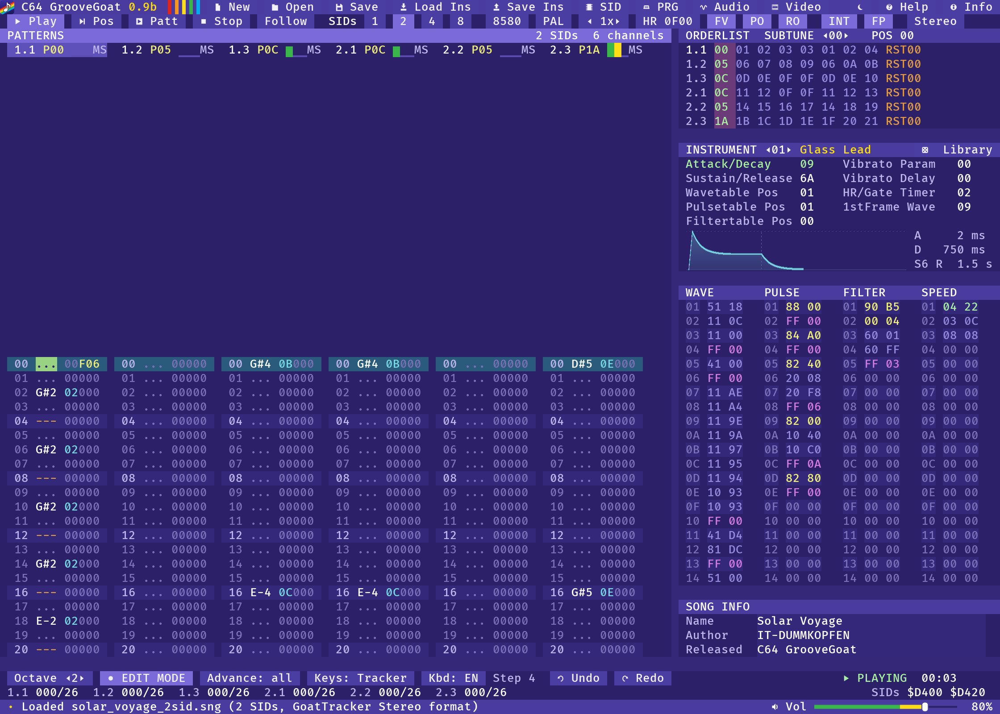
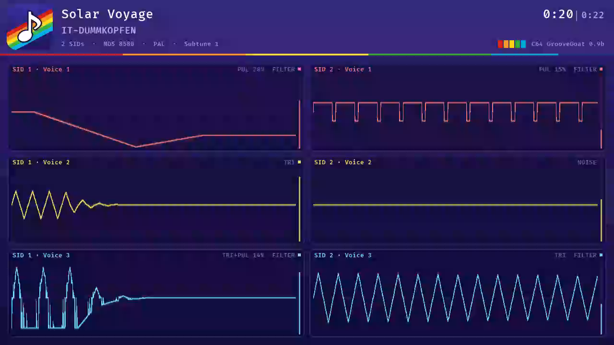

# C64 GrooveGoat

A multi-SID music editor for the Commodore 64 SID chip, by **IT-Dummkopfen**.
Version 0.9b. Based on [GoatTracker 2](https://sourceforge.net/projects/goattracker2/)
by Lasse Öörni (Cadaver) and the
[GoatTracker 2 "Silver Fork"](https://github.com/joelricci/goattracker2) by Joel Ricci.

## Features

- Songs with **1, 2, 4 or 8 SID chips** (3, 6, 12 or 24 voices), all played in the editor
  with reSID / reSID-fp, spread over the stereo field
- SID addresses `$D400 $D420 $D440 $D460 $D480 $D4A0 $D4C0 $D4E0` by default, changeable
- All GoatTracker 2 editing functions: patterns, orderlists, instruments, wave / pulse /
  filter / speed tables, multispeed, 6581 / 8580, PAL / NTSC, microtonal tunings
- Undo (`CTRL+Z`) and redo (`CTRL+Y` / `CTRL+SHIFT+Z`), keyboard layout switch EN / DE so that
  the shortcuts follow the key labels on German QWERTZ keyboards
- Modern window: SDL 2, resizable, HiDPI, mouse support, toolbar, day theme and a night theme
  in the original C64 blue
- Instrument library with more than 5000 instruments for the 6581 and the 8580, with search,
  favourites, preview and ADSR graph
- Random instrument generator (bass, acid bass, bass drum, snare, hi-hat, tom, woodwinds,
  guitars, brass, strings, leads, pads, arpeggios, bells, effects) with SID filter options
  (type, resonance, cutoff, movement) that knows the differences of the 6581 and the 8580
- Graphical ADSR envelope in the instrument editor
- Backup copies: `NAME.bak` on save, automatic backup every 2 minutes (newest 10 kept),
  crash recovery on the next start
- File formats: GoatTracker 2 `.sng` (1 SID), GoatTracker Stereo `.sng` (2 SIDs),
  C64 GrooveGoat `.ggt` (4 and 8 SIDs), GoatTracker instruments `.ins`
- Export with selectable player, zeropage and SID addresses:
  - SID files: PSID v2 (1 SID), v3 (2 SIDs), v5 multi-SID (4 and 8 SIDs)
  - runnable C64 programs with a player screen (logo sprites, song info, play time,
    subtune selection)
  - music-only PRG and BIN
- Audio export: WAV (16 bit, 44.1 / 48 kHz, stereo / mono, optionally every voice as its own
  file) and MP3 (LAME, 128-320 kbit/s, ID3 tags), with song length detection and fade-out
- Video export: MP4 (1280x720, H.264 + AAC) with an oscilloscope for every voice, arranged
  for 1, 2, 4 or 8 SIDs, song info, play time and a C64 rainbow progress bar
- Multi-SID 6502 playroutine (`src/mplayer.s`) that produces exactly the same SID register
  values per SID as the GoatTracker 2 playroutine
- Built-in manual with search and a chapter on the history of C64 SID music, keyboard reference, button help on mouse-over, welcome window,
  info dialog with all credits
- Output volume slider (0-100%, default 80%) with a soft limiter against clipping; the SID
  emulation runs in its own audio thread (no crackling when other programs are busy)
- Example song "Solar Voyage" (2 SIDs) in `examples/`

## Downloads

Ready-to-run packages for Windows 11 (x64), macOS (Apple Silicon) and Linux (x86-64 AppImage) are attached
to the [Releases](https://github.com/IT-DUMMKOPFEN/C64GrooveGoat/releases) of this repository
and can be built with `tools/package.sh` (see below).

## Building

The `Makefile` builds all three platforms from Linux:

    make TARGET=linux     # native, needs the SDL 2 headers and libSDL2
    make TARGET=appimage  # Linux for the AppImage, SDL 2 linked statically
    make TARGET=win       # Windows x64 with llvm-mingw and the SDL 2 mingw development files
    make TARGET=mac       # macOS arm64 with clang/lld, a macOS SDK and SDL2.framework
    tools/package.sh      # release packages in dist/

The toolchain locations can be set with `TOOLS=...` (see the top of the `Makefile`).
`src/gres.c` (fonts, logo, playroutines, manual) is generated by `tools/mkres.py`.
The MP3, AAC, H.264 and MP4 codecs (LAME, faac, minih264, minimp4) are included as source code
in `src/codecs` and built with the program.

## Tests

- `tests/multisid_test.sh` exports the GoatTracker example songs with the orderlists copied to
  2, 4 and 8 SIDs (direct and register buffer layouts, all playroutine options) and compares
  the SID register writes of every SID, emulated with `tools/sidtrace.c`, with the original
  single SID playroutine.
- `tools/sidtrace.c --c64` runs a runnable PRG with a minimal C64 environment;
  `tools/c64screen.py` renders its screen.
- `GG_PREVIEWTEST=1 groovegoat -E0` (or `-E1` for the 8580) previews every instrument of the
  library offline and lists the ones that stay silent; `GG_RANDOMTEST=folder` renders all
  random instrument recipes. `tools/fixlibrary.py` repairs the library instruments whose
  envelope is over within the first frame (used by `tools/package.sh`).
- `GG_REPLACETEST=1` / `GG_RANDOMREPLACETEST=1 groovegoat song.sng --export=/dev/null` replace
  every instrument of a song with library / random instruments and check that the rest of the
  song (all other instruments' table programs and all table commands in the patterns) stays the same.
- `GG_SCRIPT="..."` drives the user interface with scripted key presses and mouse clicks
  and takes screenshots (see `src/gautotest.c`).

## Command line

    groovegoat [options] [song]
    groovegoat song.ggt --export=song.sid
    groovegoat song.ggt --export=song.prg --format=prg
    groovegoat song.sng --render=song.mp3
    groovegoat song.ggt --render=song.mp4
    groovegoat song.sng --render=song.wav --stems

See the manual (`docs/manual.txt`, also built into the program) for all options.

## License

GNU General Public License v2 or later (see `copying`). The C64 playroutines
(`player.s`, `altplayer.s`, `mplayer.s`) and the PRG player frontend (`frontend.s`) do not
fall under the GPL; the music created with C64 GrooveGoat can be used freely.
LAME and faac are licensed under the GNU LGPL, minih264 and minimp4 are public domain (CC0).
See `docs/credits.txt` for the credits and licenses of all used software.
